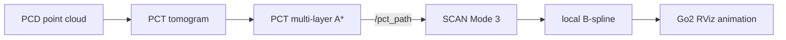

# PCT-SCAN-ROS2

PCT-SCAN-ROS2 runs PCT's multi-floor global planner together with SCAN's local trajectory planner on ROS 2 Humble. PCT chooses floors, stairs, and ramps in a tomogram. SCAN keeps generating a local B-spline along that global route. RViz shows the point cloud, the route, and the Go2 motion at the same time.

This repository is only for checking the PCT+SCAN navigation stack. Start and goal come from RViz interactive markers, and the Z axis selects the target floor directly.

<p align="center">
  
</p>

<p align="center"><em>Building: PCT multi-floor global route and SCAN quadruped local tracking</em></p>

## System architecture



PCT supplies the multi-floor topology and the route constraint. SCAN keeps its sliding map, collision model, A\* guidance, and trajectory optimization, and it replans inside a local window of the global route. This project feeds PCT's global result into SCAN Mode 3 through `/pct_path`.

## Verified scenes

| Scene    |                    Default route | Result                                      | Launch command                          |
| -------- | -------------------------------: | ------------------------------------------- | --------------------------------------- |
| Building | ground to upper floor, ~14 m rise | PCT multi-floor A\* + continuous SCAN tracking | `./scripts/launch_pct_scan_building.sh` |
| Plaza    |                          37.12 m | PCT A\*; SCAN enters continuous replanning | `./scripts/launch_pct_scan_plaza.sh`    |
| Spiral   |   38.30 m, 3.80 m climb, 2 floors | PCT A\*; SCAN runs more than 5 windows     | `./scripts/launch_pct_scan_spiral.sh`   |

### Plaza and Spiral

<table>
  <tr>
    <td width="50%" align="center">
      <br>
      <strong>Plaza</strong>: planar scene with complex obstacles
    </td>
    <td width="50%" align="center">
      <br>
      <strong>Spiral</strong>: spiral-ramp multi-floor scene
    </td>
  </tr>
</table>

## Requirements

The current code is set up for this environment:

- Ubuntu 22.04
- ROS 2 Humble
- Python 3.10
- GCC 11, or another C++17 compiler
- RViz2

Building and Plaza do not need CUDA. The Spiral tomogram generator checks for CUDA first and falls back to NumPy and SciPy when no GPU is available. The navigation demo itself does not need an NVIDIA GPU.

## Install

### 1. Get the code

```bash
git clone https://github.com/yagami-light7/PCT-SCAN-ROS2.git
cd PCT-SCAN-ROS2
```

If ROS 2 Humble is not installed yet, install the desktop variant from the official ROS 2 documentation first. The commands below assume `/opt/ros/humble/setup.bash` already exists.

### 2. Install ROS and system dependencies

```bash
sudo apt update
sudo apt install -y \
  build-essential cmake ninja-build git curl \
  python3-colcon-common-extensions python3-rosdep python3-dev python3-pip python3-venv \
  libboost-all-dev libeigen3-dev \
  libarmadillo-dev libglew-dev libglfw3-dev \
  libgl1-mesa-dev libglu1-mesa-dev
```

On the first use of rosdep, run:

```bash
sudo rosdep init
rosdep update
```

If `rosdep init` says the configuration already exists, run `rosdep update` only. Then install the dependencies declared by the ROS packages in this workspace:

```bash
source /opt/ros/humble/setup.bash
rosdep install --from-paths src --ignore-src -r -y
```

### 3. Build PCT's native dependencies

PCT uses GTSAM 4.2 and OSQP 1.0. The repository script downloads the sources and installs them under `.deps/install`. It does not change `/usr/local`, and you do not need to source another PCT workspace.

```bash
./scripts/setup_pct_dependencies.sh
```

The script uses two build jobs by default. Raise the parallelism when you have enough memory:

```bash
PCT_BUILD_JOBS=6 ./scripts/setup_pct_dependencies.sh
```

### 4. Build the workspace

```bash
./scripts/build_workspace.sh
source install/setup.bash
```

The launch scripts load ROS, this workspace, and the runtime libraries in `.deps` themselves, so you can run them directly. The `setup.bash` above is for bash. For zsh, source `install/setup.zsh` when you configure the current terminal by hand. Either shell should run `./scripts/launch_*.sh`. Do not source those launch scripts.

If GTSAM and OSQP are already installed, point the build at that directory:

```bash
PCT_DEPS_ROOT=/path/to/deps ./scripts/build_workspace.sh
```

### 5. Check the install

First confirm that ROS can find the two core packages:

```bash
source /opt/ros/humble/setup.bash
source install/setup.bash
ros2 pkg prefix pct_scan_bridge
ros2 pkg prefix scan_planner
```

Then run the headless route tests:

```bash
./scripts/test_pct_building_astar.sh --force
./scripts/test_pct_plaza_astar.sh --force
```

Both commands must print `[astar] PASS`. That means the PCT native library, the pickle, and the Python bridge are connected.

## Quick start

### Building

The Building assets ship with the repository and are the best first launch:

```bash
./scripts/launch_pct_scan_building.sh
```

After RViz opens, select `Interact` in the toolbar. Drag the green Start and the red Goal. For another floor, move the Goal along the blue Z axis onto that floor. Right-click either marker and choose `Plan route`.

To play the default multi-floor route stored in the repository:

```bash
./scripts/launch_pct_scan_building.sh plan_on_startup:=true
```

### Plaza

```bash
./scripts/launch_pct_scan_plaza.sh
```

Plan the default route automatically:

```bash
./scripts/launch_pct_scan_plaza.sh plan_on_startup:=true
```

### Spiral

The Spiral source repository does not state a clear asset license, so the PCD and the generated pickle are not distributed in Git. On the first use, run:

```bash
./scripts/fetch_spiral_asset.sh
./scripts/setup_tomography_env.sh
./scripts/generate_spiral_tomogram.sh
./scripts/test_pct_spiral_astar.sh --force
```

After the test passes, launch:

```bash
./scripts/launch_pct_scan_spiral.sh
```

All three scenes can be checked from the terminal with RViz closed:

```bash
./scripts/launch_pct_scan_building.sh \
  use_rviz:=false plan_on_startup:=true \
  publish_tomogram:=false enable_interactive_markers:=false
```

The terminal should first show PCT publishing `/pct_path`, then SCAN accepting the reference route and printing `Received trajectory N` continuously. If only the first local trajectory appears, check for a leftover node of the same name started from another workspace.

Video mode sets `enable_local_sensing:=false` by default. The PCD is still shown as the scene, and the PCT tomogram decides terrain traversability. That keeps SCAN's collision inflation from treating the dense stair cloud as a closed obstacle.

## Scene data

Building and Plaza come from the official PCT assets. This repository stores the PCD and pickle files needed to run the demos. Spiral comes from the 3D2M planner. Because that source repository does not state a clear asset license, Git stores only the download and generation scripts. Sources, parameters, and file checksums for the three scenes are recorded in `assets/<scene>/README.md`.

## Layout

```text
PCT-SCAN-ROS2/
├── src/pct/                         # buildable PCT/tomography sources
├── src/integration/pct_scan_bridge/ # PCT → SCAN ROS 2 bridge
├── src/planner/                     # SCAN planner
├── src/simulator/                   # Go2 RViz animation and original SCAN tools
├── assets/                          # scenes, tomograms, check routes, and source notes
├── scripts/                         # dependency, generation, test, and launch entry points
├── docs/                            # staged tutorials
├── LICENSES/                        # full upstream license texts
└── NOTICE                           # provenance and modification statement
```

Core interface: PCT publishes `/pct_path` (`nav_msgs/Path`). SCAN Mode 3 subscribes, simplifies it with 3D RDP, builds a piecewise-linear reference, and publishes `planning/bspline`. The piecewise-linear reference holds the global corridor through stairs and narrow passages. Smoothing is done only by the local B-spline.

A fuller account of the design and the debugging process is in:

- `docs/tutorial_phase4_pct_scan_bridge.md`
- `docs/tutorial_phase5_route_tracking.md`
- `docs/tutorial_phase7_building_rviz.md`

## Sources and licenses

- SCAN-Planner: <https://github.com/wuyi2121/SCAN-Planner>, Apache-2.0.
- PCT planner: <https://github.com/byangw/PCT_planner>. Its NOTICE states GPL v2 or later.
- PCT ROS 2 port: <https://github.com/2473o/PCT_planner/tree/feat/ros2pkg>.
- Spiral/3D2M: <https://github.com/ZJU-FAST-Lab/3D2M-planner>. No clear license was found, so its assets are not distributed in Git.

This repository is not a project that a single Apache-2.0 license can cover. The SCAN packages stay Apache-2.0. PCT, tomography, and the bridge derived directly from them use GPL-2.0-or-later. The other ROS packages keep the GPL-3.0-only or BSD-3-Clause license declared in their own `package.xml`. The full map is in [`LICENSE`](LICENSE), [`NOTICE`](NOTICE), [`THIRD_PARTY_NOTICES.md`](THIRD_PARTY_NOTICES.md), `src/pct/NOTICE`, and `LICENSES/`.

This is an engineering license audit, not legal advice. Before a public release or commercial use, check the license terms of every third-party asset and dependency again.
